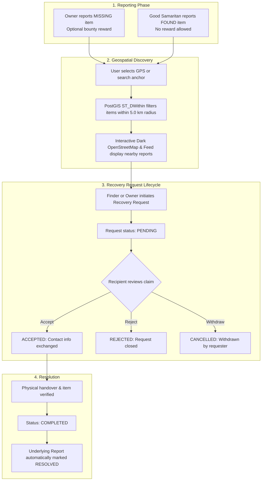
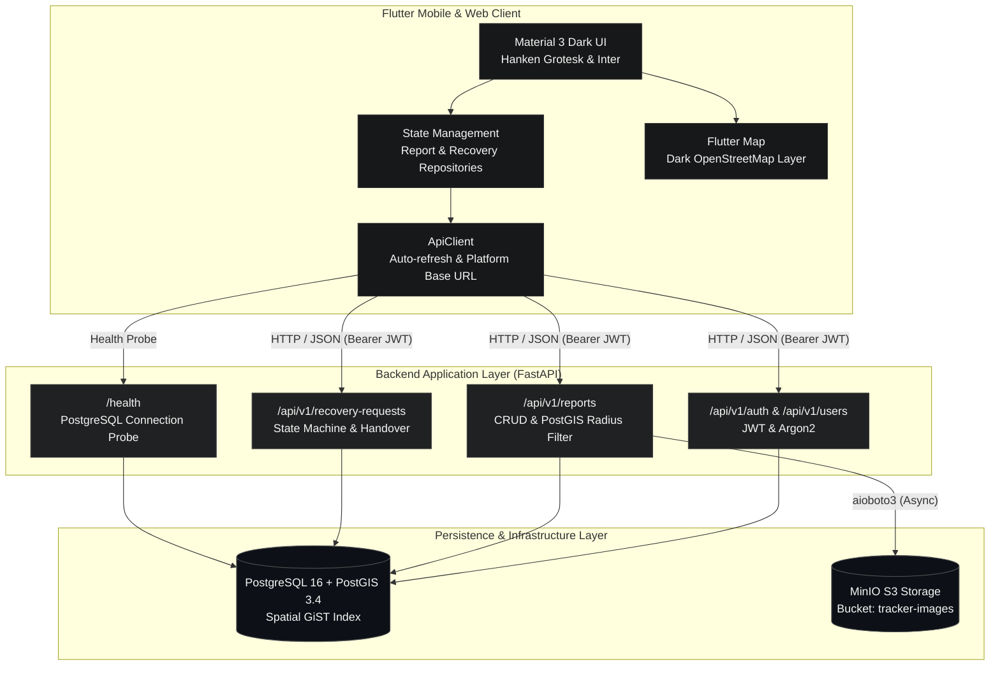
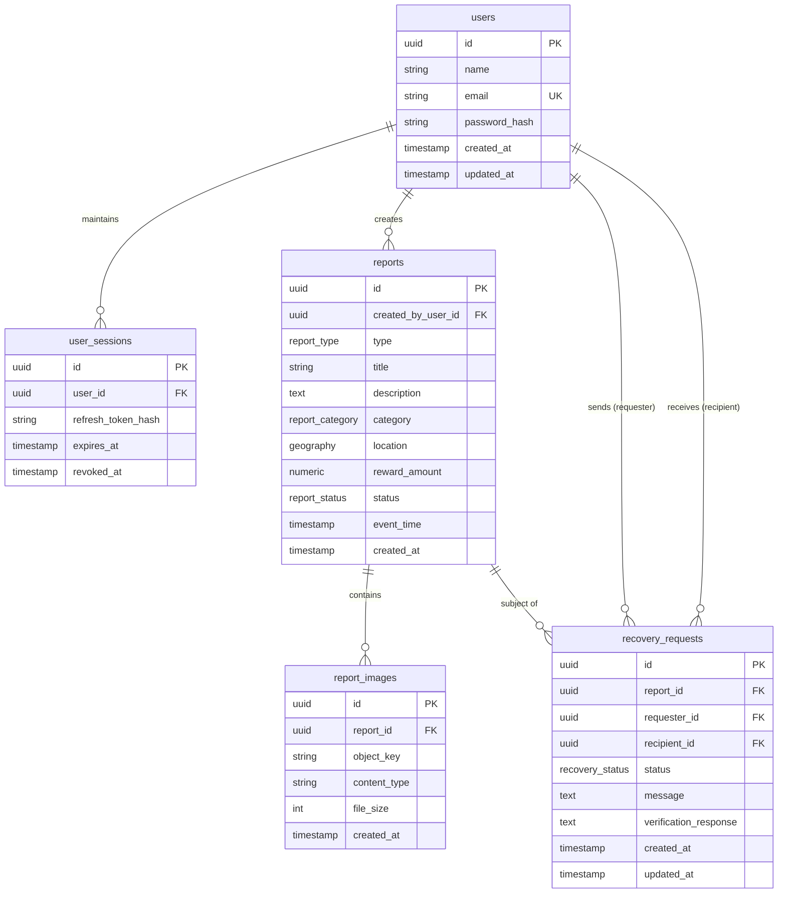

# Boomerang — Community Missing Item & Asset Tracker

> **A modern, privacy-focused lost-and-found platform combining geospatial PostGIS radius search, multi-factor item verification, and decentralized community recovery.**

---

[](https://fastapi.tiangolo.com)
[](https://www.python.org/)
[](https://postgis.net/)
[](https://flutter.dev)
[](https://www.docker.com/)
[](https://github.com/astral-sh/ruff)
[](https://mypy-lang.org/)

---

## Table of Contents

- [Overview & User Workflow](#overview--user-workflow)
- [Core Features](#core-features)
- [System Architecture](#system-architecture)
- [Technology Stack](#technology-stack)
- [Repository Structure](#repository-structure)
- [Prerequisites](#prerequisites)
- [Local Setup Guide](#local-setup-guide)
  - [1. Clone Repository](#1-clone-repository)
  - [2. Environment Setup (PowerShell)](#2-environment-setup-powershell)
  - [3. Start Infrastructure Containers](#3-start-infrastructure-containers)
  - [4. Apply Database Migrations](#4-apply-database-migrations)
  - [5. Run FastAPI Backend](#5-run-fastapi-backend)
  - [6. Configure & Run Flutter Frontend](#6-configure--run-flutter-frontend)
- [Environment Variables](#environment-variables)
- [API Reference](#api-reference)
- [Database & Geospatial Specification](#database--geospatial-specification)
- [Testing & Quality Assurance](#testing--quality-assurance)
- [Troubleshooting](#troubleshooting)
- [Security & Production Readiness](#security--production-readiness)
- [Contributing & License](#contributing--license)

---

## Overview & User Workflow

Boomerang addresses the fragmentation of traditional lost-and-found systems (social media groups, physical bulletin boards, and centralized front desks) by providing a unified geospatial platform where missing and found items are reported, discovered, and recovered safely.

### Key Principles

1. **Independent Workflows**: Reporting a **Missing** item and reporting a **Found** item are decoupled. A finder does not need a pre-existing missing report to register a found item, nor does an owner need a match before registering a loss.
2. **5.0 km Strict Geospatial Discovery**: Community lost-and-found activity is hyper-local. Reports are anchored to WGS-84 coordinates (`SRID 4326`) and queried within a strictly bounded 0.1–5.0 km radius using PostGIS spatial indexing.
3. **Structured Recovery Lifecycle**: To protect personal safety and prevent fraud, item claims proceed through a formal state machine (`PENDING` → `ACCEPTED` / `REJECTED` / `CANCELLED` → `COMPLETED`) with ownership verification before contact details are exchanged.
4. **Restrained Monochrome Design**: Built according to Boomerang's Swiss-modernist design tokens (`#080808` background, `#151515` cards, `#F5F5F5` typography) to maintain focus, high contrast, and accessibility.

### Workflow Lifecycle



---

## Core Features

### Authentication & Session Management
- **Argon2id Password Hashing**: Passwords hashed securely using `argon2-cffi`.
- **JWT Access & Refresh Token Rotation**: 30-minute access tokens with 7-day refresh tokens stored as cryptographically hashed database sessions (`user_sessions`).
- **Reactive Startup Auth Gate**: `AppRoot` routes unauthenticated users directly to `LoginScreen`, restores valid sessions to `MainNavScreen`, and cleanses state upon session revocation.
- **Transparent Refresh Retries**: Frontend `ApiClient` automatically intercepts `401 Unauthorized` responses and refreshes access tokens before replaying requests.

### Missing & Found Reporting
- **Multi-Step Guided Flow**: Select item category, enter title and description, choose spatial location anchor, and record the event timestamp.
- **Category Taxonomy**: 10 standardized categories (`ELECTRONICS`, `DOCUMENT`, `WALLET`, `BAG`, `KEYS`, `JEWELRY`, `PET`, `VEHICLE`, `CLOTHING`, `OTHER`).
- **Reward Guardrails**: Optional monetary reward (`reward_amount >= 0`) supported exclusively for `MISSING` reports. Disabled and stripped for `FOUND` reports.
- **Report Lifecycle**: Transitions across `ACTIVE`, `RESOLVED`, and `CANCELLED`.

### Geospatial Search & Interactive Mapping
- **Spatial Indexing**: PostGIS `geography(POINT, 4326)` geometry with spatial GiST indexes.
- **Spherical Filtering**: `ST_DWithin` calculates distances in meters against the WGS-84 ellipsoid; `ST_Distance` calculates proximity for distance-based sorting.
- **Enforced 5.0 km Radius**: Backend query validation restricts `radius_km` between `0.0` and `5.0` with at most one decimal place.
- **Keyless Dark OSM Map**: Flutter map renders keyless OpenStreetMap raster tiles through a luminance color filter matrix (`MapConfig.darkTileBuilder`) to deliver a high-contrast dark theme without proprietary API keys.
- **Instant Map Recentering**: Map canvas instantly recenters (`MapController.move`) upon GPS detection or manual place selection via OpenStreetMap Nominatim.

### Media & Object Storage
- **MinIO / AWS S3 Integration**: Asynchronous object storage via `aioboto3`.
- **Validation**: Strict MIME type checking (`image/jpeg`, `image/png`, `image/webp`) and 5 MB per-file size limit.
- **Report Gallery**: Up to 5 images per report with creator-authenticated upload and deletion.

### Recovery Request State Machine
- **Anti-Spam & Concurrency Controls**: Database check constraint prevents self-recovery (`requester_id != recipient_id`). Active request uniqueness ensures only one pending/accepted claim per user per report.
- **Verification Notes**: Requesters provide identification notes to establish proof of ownership.
- **Automatic Resolution**: Marking a recovery request as `COMPLETED` automatically transitions the associated report to `RESOLVED`.

---

## System Architecture



> **Note on Event Streaming**: Apache Kafka integration (`aiokafka`) is defined in the architectural blueprint for background alert dispatching and telemetry fan-out. The current operational service runs synchronously on FastAPI with PostgreSQL/PostGIS.

---

## Technology Stack

| Component | Technology | Version / Specification | Purpose |
| :--- | :--- | :--- | :--- |
| **API Framework** | FastAPI | `^0.100.0` | Asynchronous high-performance REST API |
| **ASGI Server** | Uvicorn | `^0.23.0` | Production ASGI web server |
| **Database** | PostgreSQL + PostGIS | `16-3.4` (Docker) | Spatial data storage and geographic indexing |
| **ORM & Migrations** | SQLAlchemy & Alembic | `2.x` / `^1.11.0` | Async database models and transactional schema migrations |
| **Spatial Driver** | GeoAlchemy2 | `^0.14.0` | Spatial type mapping and SQL functions (`ST_DWithin`, `ST_Distance`) |
| **Validation** | Pydantic v2 | `^2.0.0` | Request validation, schema serialization, and settings |
| **Authentication** | PyJWT & Argon2-cffi | `^2.8.0` / `^23.0.0` | Cryptographic password hashing and signed JWT tokens |
| **Object Storage** | MinIO (AWS S3 compatible) | `elestio/minio:latest` | S3-compliant image storage managed with `aioboto3` |
| **Frontend Framework** | Flutter & Dart | `Flutter 3.x / Dart 3.x` | Cross-platform UI for Web, Mobile, and Desktop |
| **Mapping Engine** | `flutter_map` & `latlong2` | `^8.3.2` / `^0.10.1` | Map rendering and vector calculations |
| **Secure Storage** | `flutter_secure_storage` | `^11.2.0` | Hardware-backed keystore/keychain token persistence |
| **Geocoding** | Nominatim API | OSM Public API | OpenStreetMap place lookup and coordinate resolving |

---

## Repository Structure

```text
GetMe/
├── .agents/                    # Project specifications, design policy, and agent memory
├── alembic/                    # Alembic migration environment and versions
│   └── versions/               # Schema migrations (Domain model, Auth, Images/Recovery)
├── app/                        # FastAPI backend application
│   ├── api/                    # HTTP route handlers
│   │   ├── auth.py             # /api/v1/auth & /api/v1/users endpoints
│   │   ├── deps.py             # Dependency injection (Auth, DB, S3)
│   │   ├── recovery.py         # /api/v1/recovery-requests endpoints
│   │   └── reports.py          # /api/v1/reports & image upload endpoints
│   ├── core/                   # Application settings and security utilities
│   │   └── config.py           # Pydantic BaseSettings loading from .env
│   ├── db/                     # Database engine and SQLAlchemy models
│   │   ├── database.py         # Async engine and session maker
│   │   └── models.py           # User, UserSession, Report, ReportImage, RecoveryRequest
│   ├── schemas/                # Pydantic request and response contracts
│   │   ├── auth.py             # User and token schemas
│   │   ├── geo.py              # Geospatial parameter validation
│   │   ├── recovery.py         # Recovery request payloads
│   │   └── report.py           # Report creation and listing schemas
│   ├── services/               # Core business logic
│   │   ├── auth.py             # Token generation and password verification
│   │   ├── recovery.py         # Recovery state machine orchestration
│   │   ├── report.py           # Spatial querying and report lifecycle
│   │   └── storage.py          # Asynchronous S3 file operations
│   └── main.py                 # FastAPI initialization, CORS, global exception handler
├── frontend/                   # Flutter application
│   ├── lib/
│   │   ├── models/             # Dart data models (UserModel, ReportModel, RecoveryRequestModel)
│   │   ├── services/           # ApiClient, AuthService, Repositories, Geocoding, Location
│   │   ├── ui/
│   │   │   ├── screens/        # Home, Map, Create, Details, My Reports, Profile, Auth
│   │   │   └── widgets/        # AppToast, LocationSelectionSheet, shared UI units
│   │   ├── main.dart           # App entrypoint and reactive AppRoot auth gate
│   │   └── theme.dart          # Dark theme tokens, typography, and component styling
│   ├── test/                   # Comprehensive widget, unit, and integration tests
│   └── pubspec.yaml            # Flutter dependencies and assets
├── tests/                      # Backend pytest test suite (Auth, Geo, Models, Reports, Recovery)
├── docker-compose.yml          # Containerized PostGIS 16 and MinIO services
├── pyproject.toml              # Ruff, mypy, and pytest configuration
├── requirements.txt            # Pinned backend Python dependencies
├── .env.example                # Safe environment variable template
└── README.md                   # Project documentation
```

---

## Prerequisites

Before setting up Boomerang locally, ensure the following dependencies are installed on your host system:

- **Operating System**: Windows 10/11, macOS, or Linux.
- **Python**: `3.12` or higher (verified with Python `3.12` and `3.14`).
- **Flutter SDK**: `3.x` with Dart `3.x` (`flutter --version`).
- **Docker Desktop**: With Docker Compose v2 (`docker compose version`).
- **Web Browser**: Google Chrome (for Flutter web execution and testing).

---

## Local Setup Guide

Follow this sequential guide to configure and run the complete Boomerang development environment.

### 1. Clone Repository

```powershell
git clone <repository-url>
cd GetMe
```

### 2. Environment Setup (PowerShell)

Create and activate a Python virtual environment, then install backend dependencies:

```powershell
# Create virtual environment
python -m venv .venv

# Activate environment in PowerShell
.\.venv\Scripts\Activate.ps1

# Upgrade pip and install pinned dependencies
.\.venv\Scripts\python.exe -m pip install --upgrade pip
.\.venv\Scripts\python.exe -m pip install -r requirements.txt

# Copy example environment configuration
Copy-Item .env.example .env
```

> **Note**: For Linux/macOS users, activate with `source .venv/bin/activate` and use `cp .env.example .env`.

### 3. Start Infrastructure Containers

Launch PostgreSQL/PostGIS and MinIO using Docker Compose:

```powershell
docker compose up -d
```

Verify that both containers are running and healthy:

```powershell
docker ps --format "table {{.Names}}\t{{.Status}}\t{{.Ports}}"
```

Expected output:
```text
NAMES           STATUS                    PORTS
tracker_db      Up (healthy)              0.0.0.0:5432->5432/tcp
tracker_minio   Up                        0.0.0.0:9000-9001->9000-9001/tcp
```

### 4. Apply Database Migrations

Apply the Alembic migrations to create the database tables, spatial indexes, and check constraints:

```powershell
.\.venv\Scripts\python.exe -m alembic upgrade head
```

### 5. Run FastAPI Backend

Start the Uvicorn development server:

```powershell
.\.venv\Scripts\python.exe -m uvicorn app.main:app --reload --port 8000
```

Verify the health check in a separate terminal:

```powershell
curl http://127.0.0.1:8000/health
```

Expected response:
```json
{"status":"ok","database":"ok"}
```

Interactive OpenAPI documentation is immediately available at:
- Swagger UI: `http://127.0.0.1:8000/docs`
- ReDoc: `http://127.0.0.1:8000/redoc`

### 6. Configure & Run Flutter Frontend

Open a new terminal window, navigate to `frontend/`, fetch packages, and run the app:

```powershell
cd frontend
flutter pub get
```

#### Running on Google Chrome (Recommended for local evaluation):

```powershell
flutter run -d chrome
```

#### Platform-Specific Base URLs:

Boomerang's `ApiClient` automatically resolves the backend address based on the active runtime:

| Platform | Default Backend Target | Custom Override Command |
| :--- | :--- | :--- |
| **Chrome (Web)** | `http://127.0.0.1:8000` | `flutter run -d chrome --dart-define=API_BASE_URL=http://localhost:8000` |
| **Android Emulator** | `http://10.0.2.2:8000` | Automatic alias for host machine `127.0.0.1` |
| **Physical Mobile Device** | LAN IP of dev machine | `flutter run -d <device> --dart-define=API_BASE_URL=http://192.168.1.X:8000` |
| **Windows Desktop** | `http://127.0.0.1:8000` | `flutter run -d windows` |

---

## Environment Variables

All backend configuration is managed through environment variables loaded by `app/core/config.py` from `.env`.

| Variable | Description | Default / Example | Required |
| :--- | :--- | :--- | :--- |
| `PROJECT_NAME` | Name displayed in OpenAPI documentation | `"Community Missing Item & Asset Tracker"` | No |
| `API_V1_STR` | URL prefix for API version 1 routes | `"/api/v1"` | No |
| `POSTGRES_SERVER` | Hostname or IP of PostgreSQL instance | `localhost` | Yes |
| `POSTGRES_PORT` | Port for PostgreSQL service | `5432` | Yes |
| `POSTGRES_USER` | Database username | `postgres` | Yes |
| `POSTGRES_PASSWORD`| Database password | `postgres` | Yes |
| `POSTGRES_DB` | Database schema name | `tracker_db` | Yes |
| `SECRET_KEY` | Secret key for signing JWT tokens | Generate via `openssl rand -hex 32` | Yes |
| `ALGORITHM` | JWT signing algorithm | `HS256` | No |
| `ACCESS_TOKEN_EXPIRE_MINUTES` | Access token lifespan in minutes | `30` | No |
| `REFRESH_TOKEN_EXPIRE_DAYS` | Refresh session lifespan in days | `7` | No |
| `S3_ENDPOINT_URL` | S3 / MinIO API endpoint | `http://localhost:9000` | Yes |
| `S3_ACCESS_KEY` | MinIO root username / access key | `minioadmin` | Yes |
| `S3_SECRET_KEY` | MinIO root password / secret key | `minioadmin` | Yes |
| `S3_BUCKET_NAME` | Target S3 bucket for report images | `tracker-images` | Yes |
| `S3_REGION_NAME` | S3 signing region | `us-east-1` | No |

---

## API Reference

The backend exposes a fully typed REST API with interactive Swagger docs at `http://127.0.0.1:8000/docs`.

### Health Check

| Method | Endpoint | Auth | Description |
| :--- | :--- | :--- | :--- |
| `GET` | `/health` | None | Probes PostgreSQL connectivity; returns `{"status":"ok","database":"ok"}`. |

### Authentication & Users

| Method | Endpoint | Auth | Description |
| :--- | :--- | :--- | :--- |
| `POST` | `/api/v1/auth/register` | None | Register new user with `{name, email, password}`. Returns `201 Created`. |
| `POST` | `/api/v1/auth/login` | None | Authenticate with `{email, password}`. Returns access and refresh tokens. |
| `POST` | `/api/v1/auth/refresh` | None | Exchange `{refresh_token}` for rotated access and refresh tokens. |
| `POST` | `/api/v1/auth/logout` | None | Revoke `{refresh_token}` session. Returns `204 No Content`. |
| `GET` | `/api/v1/users/me` | Bearer | Retrieve profile for authenticated user (`{id, name, email, created_at}`). |

### Reports & Geospatial Search

| Method | Endpoint | Auth | Description |
| :--- | :--- | :--- | :--- |
| `POST` | `/api/v1/reports` | Bearer | Create a new report. Required: `{type, title, description, category, latitude, longitude, event_time}`. Optional: `{reward_amount}` (Missing only). |
| `GET` | `/api/v1/reports` | Optional | List paginated reports. Query parameters: `type`, `category`, `status`, `search`, `page`, `page_size`, `sort` (`newest`, `oldest`, `distance`).<br/>**Geo Parameters**: `latitude`, `longitude`, `radius_km` (0.1–5.0 km, all three required together). |
| `GET` | `/api/v1/reports/{id}` | Optional | Retrieve report details by UUID including attached images. |
| `PATCH` | `/api/v1/reports/{id}` | Bearer | Update report details or status (`ACTIVE` → `RESOLVED` / `CANCELLED`). Creator only. |

### Report Images

| Method | Endpoint | Auth | Description |
| :--- | :--- | :--- | :--- |
| `POST` | `/api/v1/reports/{id}/images` | Bearer | Upload an image (`multipart/form-data`). JPEG, PNG, WebP $\le 5\text{ MB}$. Max 5 images per report. Creator only. |
| `DELETE` | `/api/v1/reports/{id}/images/{img_id}` | Bearer | Delete a stored image from MinIO and database. Creator only. |

### Recovery Requests

| Method | Endpoint | Auth | Description |
| :--- | :--- | :--- | :--- |
| `POST` | `/api/v1/recovery-requests` | Bearer | Initiate claim on active report with `{report_id, message}`. Requester cannot be report creator. |
| `GET` | `/api/v1/recovery-requests` | Bearer | List recovery requests involving the caller. Filter by `type` (`received`, `sent`, `all`) and `status`. |
| `GET` | `/api/v1/recovery-requests/{id}` | Bearer | Retrieve details of a recovery request. Caller must be requester or recipient. |
| `PATCH`| `/api/v1/recovery-requests/{id}` | Bearer | Update request status (`ACCEPTED`, `REJECTED`, `CANCELLED`, `COMPLETED`) with optional verification notes. |

---

## Database & Geospatial Specification

### Entity Relationship Model



### Geospatial Implementation Details
- **WGS-84 Geography Point**: Columns are stored as `Geography(geometry_type="POINT", srid=4326)`.
- **Spatial Index**: PostGIS automatically provisions GiST indexes over geography types, allowing efficient spherical bounding-box filtering.
- **Distance Calculation**:
  ```sql
  -- Spatial query executed in report_service.py
  WHERE ST_DWithin(reports.location, ST_SetSRID(ST_Point(:lon, :lat), 4326), :radius_meters)
  ORDER BY ST_Distance(reports.location, ST_SetSRID(ST_Point(:lon, :lat), 4326)) ASC;
  ```

---

## Testing & Quality Assurance

Boomerang enforces continuous quality gates across both frontend and backend repositories.

### 1. Backend Verification

Ensure infrastructure containers (`tracker_db`, `tracker_minio`) are running before executing integration tests:

```powershell
# Run the complete test suite (29 tests)
.\.venv\Scripts\python.exe -m pytest

# Code linting check
.\.venv\Scripts\python.exe -m ruff check app tests

# Format check
.\.venv\Scripts\python.exe -m ruff format --check app tests

# Strict type check
.\.venv\Scripts\python.exe -m mypy app tests
```

**Latest Verified Backend Results**:
- **Pytest**: 29 passed in 23.6s (100% pass rate).
- **Ruff**: Clean (0 lint errors).
- **Mypy**: Success (0 errors across 27 source files).

### 2. Frontend Verification

Run tests and static analysis inside the `frontend/` directory:

```powershell
cd frontend

# Run all widget, unit, and state integration tests (121 tests)
flutter test

# Static analysis
flutter analyze

# Verify code formatting
dart format --output=none --set-exit-if-changed .
```

**Latest Verified Frontend Results**:
- **Flutter Test**: 121 passed out of 121 tests across 9 test suites.
- **Flutter Analyze**: 0 issues found.
- **Dart Format**: 40 files formatted cleanly.

---

## Troubleshooting

### 1. Port 8000 in Use or `WinError 10013`
If another service or previous Uvicorn process is holding port 8000:
```powershell
# Find process using port 8000
Get-NetTCPConnection -LocalPort 8000 -ErrorAction SilentlyContinue | Select-Object OwningProcess

# Kill process by ID
Stop-Process -Id <PID> -Force
```

### 2. Database Connection Refused
If `alembic` or `pytest` fails with `connection to server at "localhost" failed`:
- Verify Docker is running: `docker ps`
- Inspect container health: `docker inspect --format="{{json .State.Health}}" tracker_db`
- Ensure `.env` uses `POSTGRES_SERVER=localhost` and `POSTGRES_PORT=5432`.

### 3. S3 Bucket Initialization
If image upload returns `NoSuchBucket`:
- The bucket `tracker-images` is initialized automatically on first upload by `app.services.storage.init_bucket()`.
- Access the MinIO web console at `http://localhost:9001` (User: `minioadmin`, Password: `minioadmin`) to inspect bucket state manually.

### 4. Android Emulator Cannot Reach Backend
- When testing on an Android emulator, `localhost` points to the emulator itself.
- Boomerang's `ApiClient` automatically maps Android requests to `http://10.0.2.2:8000`.
- If using a physical Android device, connect both computer and phone to the same Wi-Fi network and launch with:
  ```powershell
  flutter run -d <device> --dart-define=API_BASE_URL=http://<YOUR_LAN_IP>:8000
  ```

### 5. Nominatim Geocoding Rate Limits
- Place search uses OpenStreetMap's Nominatim public geocoding service.
- Nominatim enforces an acceptable usage policy of maximum 1 request per second.
- `GeocodingService` in `frontend/lib/services/geocoding_service.dart` includes debouncing and a custom User-Agent to respect OSM guidelines.

---

## Security & Production Readiness

### Current Status: Pre-Production / Development Reference

Boomerang is actively maintained as a reference architecture. Before deploying to an internet-facing production environment, address the following operational requirements:

1. **Secret Key Management**:
   - Replace development placeholder keys in `.env` with cryptographically random 256-bit keys (`openssl rand -hex 32`).
   - Store production credentials in an external secrets manager (AWS Secrets Manager, HashiCorp Vault, or GCP Secret Manager).
2. **CORS Restrictions**:
   - `app/main.py` currently allows wildcard origins (`allow_origins=["*"]`) for multi-platform local development.
   - Restrict `allow_origins` to trusted domain origins in production deployments.
3. **Platform Secure Token Storage**:
   - `frontend/lib/services/token_storage.dart` uses `flutter_secure_storage` on mobile devices with transparent memory fallback on platforms without keystore channels.
   - For web production, implement HttpOnly, SameSite cookies to protect tokens against XSS.
4. **TLS Termination & Reverse Proxy**:
   - Terminate SSL/TLS via Nginx, Traefik, or an AWS Application Load Balancer. Do not expose Uvicorn directly to the public internet.
5. **Rate Limiting**:
   - Apply IP and user-based rate limiting on sensitive routes (`/api/v1/auth/login`, `/api/v1/reports`, `/api/v1/recovery-requests`) using Redis and slowapi.

---

## Contributing & License

### Local Contribution Workflow

1. Ensure all backend tests pass: `pytest`
2. Ensure strict type checking passes: `mypy app tests`
3. Ensure formatting and linter pass: `ruff check app tests` and `ruff format --check app tests`
4. Ensure frontend tests and analysis pass: `flutter analyze` and `flutter test`
5. Verify changes locally on Chrome or desktop viewport before submitting.

### License

No formal open-source license is currently provided with this repository. All rights are reserved by the project owners. For collaboration or licensing inquiries, contact the repository maintainers.