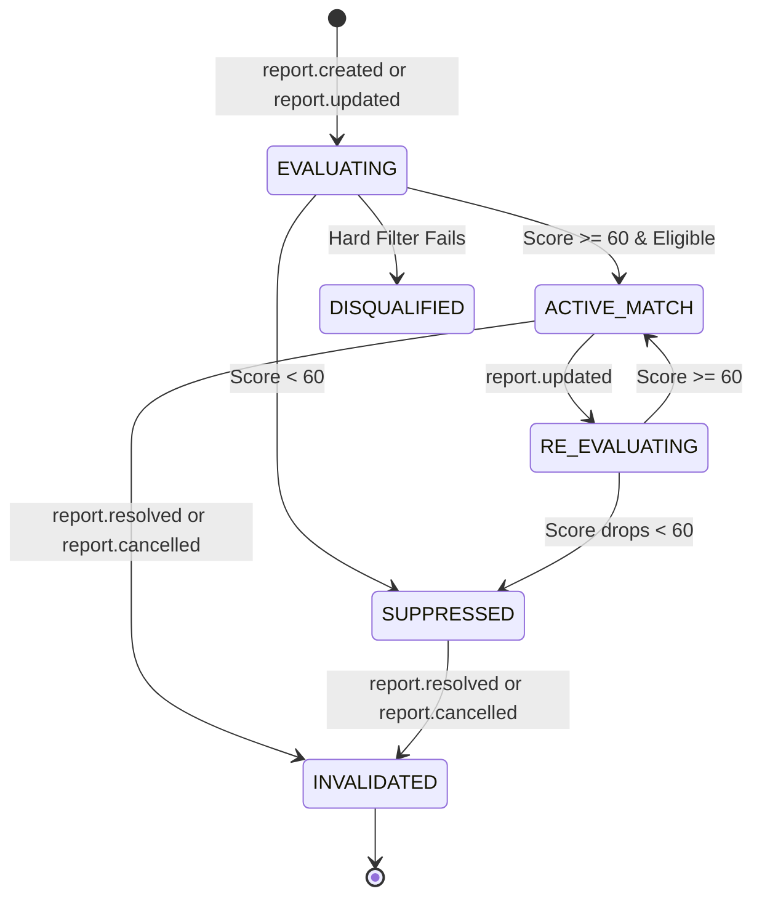

# Boomerang Missing/Found Matching Engine Specification (Phase 8.1)

> **Status Notice**: Phase 8.1 defines the formal design, eligibility criteria, scoring rules, lifecycle transitions, and evaluation plan for the Boomerang Missing/Found Matching Engine.
> **Implementation Scope**: This document establishes architectural rules and domain specifications only. Candidate retrieval (Phase 8.2), scoring algorithms (Phase 8.3), and consumer worker services (Phase 8.4) are **NOT** implemented in this phase. Database migrations and new API routes are intentionally deferred.

---

## 1. System Role & Architecture Context

Boomerang's core mission is connecting people who lost something with people who found something within the same local community. The **Matching Engine** is an asynchronous, event-driven subsystem designed to detect potential correspondences between `MISSING` and `FOUND` reports.

### 1.1 Architectural Context

```text
┌────────────────────────────────────────────────────────┐
│                   PostgreSQL Database                  │
│  - reports (ReportType, Geography POINT, event_time)   │
│  - outbox_events (Transactional Outbox)                │
│  - consumer_events (Durable Idempotency Barrier)       │
└───────────────────────────┬────────────────────────────┘
                            │
              1. Outbox Event Committed Atomically
                            ▼
┌────────────────────────────────────────────────────────┐
│                   Outbox Dispatcher                    │
│  Publishes to Kafka topic: 'boomerang.domain.events'   │
└───────────────────────────┬────────────────────────────┘
                            │
              2. Domain Event Delivery (At-Least-Once)
                            ▼
┌────────────────────────────────────────────────────────┐
│            Matching Engine Consumer Worker             │
│  - Subscribes to: report.created, report.updated,       │
│                   report.resolved                      │
│  - Consumer Name: 'matching_engine'                    │
│  - Consumer Group: 'boomerang.matching_engine.group'   │
└─────────────┬───────────────────────────┬──────────────┘
              │                           │
  3. Query Candidates         4. Store Match Results &
     (PostGIS ST_DWithin)        Emit match.detected
              ▼                           ▼
┌───────────────────────────┐ ┌──────────────────────────┐
│ PostgreSQL Spatial Engine │ │   Notification Engine    │
│  - Radius <= 5.0 km       │ │  (Phase 9 Consumer)      │
│  - Opposite Report Type   │ │  - High-priority alerts  │
│  - Status == ACTIVE       │ │  - Alert deduplication   │
└───────────────────────────┘ └──────────────────────────┘
```

### 1.2 Separation of Concerns
1. **Kafka's Role**: Transports immutable domain events (`report.created`, `report.updated`, `report.resolved`) reliably with partition ordering keyed by `aggregate_id` (`report_id`). Kafka does **not** store match state or perform query filtering.
2. **PostgreSQL / PostGIS's Role**: Evaluates spatial constraints (`ST_DWithin`), status criteria, and candidate indexes. Serves as the source of truth for reports and future match entities.
3. **Application Logic's Role**: Computes normalized multi-signal ranking scores, enforces minimum-evidence barriers, handles deduplication, and manages match lifecycle states.

---

## 2. Bidirectional Matching

Matching is symmetric and bidirectional:
1. **Missing-to-Found Search**: When a new `MISSING` report is created or updated, the system queries existing active `FOUND` reports within 5.0 km.
2. **Found-to-Missing Search**: When a new `FOUND` report is created or updated, the system queries existing active `MISSING` reports within 5.0 km.
3. **Temporal Asymmetry & Delayed Reports**:
   - Items are frequently reported lost days or weeks after the loss incident occurred.
   - Similarly, finders may hold an item for several days before posting a report, or an owner may post days before a finder turns in an item.
   - The matching engine must match a newly created report against older opposite-type reports, regardless of the delta between report submission dates (`created_at`).
   - Temporal comparison relies on incident occurrence time (`event_time`), not report submission time.
4. **Asynchronous Decoupling**:
   - Report creation/editing REST endpoints (`POST /api/v1/reports`, `PATCH /api/v1/reports/{id}`) commit report changes and outbox records in < 50 ms without blocking on spatial cross-scans or scoring loops.
   - Matching is triggered asynchronously when the event consumer processes the corresponding Kafka event.

---

## 3. Candidate Eligibility & Hard Filters

Before calculating similarity scores, candidate pairs must satisfy strict binary eligibility criteria. If any hard filter fails, the pair is immediately discarded without computing component scores.

| Rule # | Eligibility Check | Criterion / Implementation Rule | Rationale |
| :--- | :--- | :--- | :--- |
| **HF-1** | **Opposite Report Types** | `Report_A.type != Report_B.type`<br>Exactly one `MISSING` and one `FOUND`. | A missing item cannot match another missing item; a found item cannot match another found item. |
| **HF-2** | **Self-Match Exclusion** | `Report_A.id != Report_B.id` AND `Report_A.created_by_user_id != Report_B.created_by_user_id` | Prevents comparing a report to itself or matching reports created by the same user account. |
| **HF-3** | **Active Lifecycle Status** | `Report_A.status == ACTIVE` AND `Report_B.status == ACTIVE` | Reports in `RESOLVED`, `EXPIRED`, or `CANCELLED` states are disqualified from matching. |
| **HF-4** | **Incident Coordinates** | Coordinates must be derived strictly from `Report.location` (`Geography(POINT, 4326)`). | Never use client UI discovery anchors or map viewports for candidate matching. |
| **HF-5** | **Geographic Boundary (5.0 km)** | `ST_DWithin(Report_A.location, Report_B.location, 5000.0)` | Reuses established PostGIS query conventions (`radius_km <= 5.0`). The 5.0 km boundary is inclusive in PostGIS `ST_DWithin`. Pairs beyond 5.0 km are strictly excluded. |
| **HF-6** | **Category Compatibility** | Category match or valid hierarchy overlap (see Section 3.1). | Incompatible categories (e.g. `PET` vs `ELECTRONICS`) are discarded immediately. |
| **HF-7** | **Privacy & Authorization** | Respect user boundaries; verification responses and sensitive credentials remain excluded. | Report matching utilizes only public report attributes (`title`, `description`, `category`, `location`, `event_time`, `reward_amount`). |

### 3.1 Category Compatibility Rules
Existing categories in `ReportCategory` enum:
- `ELECTRONICS`
- `DOCUMENT`
- `WALLET`
- `BAG`
- `KEYS`
- `JEWELRY`
- `PET`
- `VEHICLE`
- `CLOTHING`
- `OTHER`

**Compatibility Matrix**:
- **Exact Category Match**: `Report_A.category == Report_B.category` $\rightarrow$ Fully compatible.
- **Cross-Category Incompatibility**: Concrete, distinct categories are strictly mutually exclusive:
  - `PET` never matches `ELECTRONICS`, `DOCUMENT`, `WALLET`, `VEHICLE`, etc.
  - `VEHICLE` never matches `JEWELRY` or `KEYS`.
- **The `OTHER` Category Policy**:
  - `OTHER` acts as a wildcard catch-all for uncommon items (e.g., musical instruments, sports equipment, medical devices).
  - A report with category `OTHER` is eligible to match another report with category `OTHER`, or a specific category **only if** strong text/identity evidence is present ($I \ge 60$).
  - When comparing `OTHER` against a specific category, an identity penalty of 20 points is applied to prevent generic false-positive floods.
- **Future Subcategory Hierarchy**:
  - Future phases may introduce hierarchical taxonomies (e.g. `ELECTRONICS.PHONE.APPLE.IPHONE_15_PRO`).
  - Rule: Subcategories within the same parent category are compatible; crossing parent branches is prohibited unless one branch is generic.

---

## 4. Provisional Scoring Formulation

For candidate pairs that satisfy all hard filters, the engine computes a provisional composite ranking score $S \in [0, 100]$:

$$S = 0.30 I + 0.30 C + 0.25 D + 0.15 T$$

Where each component signal is normalized to the range $[0, 100]$:
- $I$: Item Identity (Name, Category, Brand, Model)
- $C$: Physical Characteristics (Color, Materials, Case/Cover, Marks, Stickers, Scratches)
- $D$: Geographic Proximity (Physical distance between incident coordinates)
- $T$: Incident-Time Compatibility (Temporal delta between reported loss and discovery)

> [!IMPORTANT]
> The composite score $S$ is a **ranking score**, not a calibrated probability. The weights ($0.30, 0.30, 0.25, 0.15$) and distance functions are design proposals subject to calibration during Phase 8.3 evaluation.

### 4.1 Signal Breakdown

#### Signal I: Item Identity (Weight: 0.30)
Evaluates core entity classification:
- **Category Alignment** (40% of $I$): Exact category match = 40 pts; `OTHER` fallback = 15 pts.
- **Brand & Model Matching** (40% of $I$): Token overlap of normalized brand names (e.g. "Apple", "Samsung", "Sony", "Trek") and model numbers/names ("iPhone 15 Pro", "Galaxy S23", "QuietComfort 45").
- **Core Title Noun Alignment** (20% of $I$): Lemmatized noun token overlap from `Report.title`.

#### Signal C: Physical Characteristics (Weight: 0.30)
Evaluates specific visual and physical attributes extracted from `Report.description` and title:
- **Color Overlap**: Matched color tokens (e.g. "matte black", "navy blue", "silver", "tortoiseshell").
- **Protective Covers & Accessories**: Matched accessories (e.g. "OtterBox case", "leather strap", "carabiner", "rhinestone charm").
- **Distinctive Identifiers & Marks**: Scratches, engravings, stickers, broken corners, initials, or unique wear.
- **Contradiction Penalty**: If Report A states "bright red case" and Report B states "clear transparent case", apply a heavy penalty (subtract 40–60 points from $C$).

#### Signal D: Geographic Proximity (Weight: 0.25)
Evaluates spatial proximity using PostGIS incident coordinates. Proximity within the maximum 5.0 km radius uses the illustrative linear decay rule:

$$D = \max\left(0, \min\left(100, 100 \times \left(1 - \frac{\text{distance\_km}}{5.0}\right)\right)\right)$$

**Boundary & Semantic Constraints**:
- `distance_km` is computed via PostGIS `ST_Distance(Report_A.location, Report_B.location) / 1000.0`.
- A candidate located at the exact 5.0 km boundary is eligible according to `ST_DWithin` semantics, but receives exactly $D = 0$ points.
- Proximity benchmarks:
  - $0.0\text{ km}$ (same coordinate): $D = 100.0$
  - $0.5\text{ km}$: $D = 90.0$
  - $1.0\text{ km}$: $D = 80.0$
  - $2.5\text{ km}$: $D = 50.0$
  - $4.0\text{ km}$: $D = 20.0$
  - $5.0\text{ km}$: $D = 0.0$
  - $> 5.0\text{ km}$: Ineligible (filtered out by HF-5 before scoring).

#### Signal T: Incident-Time Compatibility (Weight: 0.15)
Evaluates temporal consistency based on `Report.event_time` (when loss or discovery occurred):
- **Temporal Order Rule**: In the physical world, an item must be lost *at or before* it is found:
  $$\Delta t = \text{event\_time}_{\text{FOUND}} - \text{event\_time}_{\text{MISSING}}$$
- **Ideal Range**: $\Delta t \in [0, 7\text{ days}]$ $\rightarrow$ $T = 100$.
- **Moderate Gap**: $\Delta t \in (7\text{ days}, 30\text{ days}]$ $\rightarrow$ $T = 75$.
- **Extended Gap**: $\Delta t \in (30\text{ days}, 90\text{ days}]$ $\rightarrow$ $T = 40$.
- **Extreme Gap**: $\Delta t > 90\text{ days}$ $\rightarrow$ $T = 10$.
- **Negative Time Delta (Found before Lost)**:
  - Small negative delta ($\Delta t \in [-24\text{ hours}, 0)$): Permitted with moderate penalty ($T = 50$) to accommodate user timestamp estimation uncertainty and time zone mistakes.
  - Large negative delta ($\Delta t < -24\text{ hours}$): Strong mismatch penalty ($T = 0$), as an item cannot be found days before it was reported lost.

---

## 5. Handling Missing, Sparse, and Contradictory Information

### 5.1 Missing Information Is Not a Mismatch
Users frequently omit details due to stress, lack of knowledge, or haste:
- A missing model number or unknown color does not automatically imply non-correspondence.
- Neutral missing attributes do not penalize a candidate down to zero, but they must **never** be treated as a positive match.

### 5.2 Anti-Sparse Scoring Guard & Minimum-Evidence Requirement
> [!WARNING]
> A major vulnerability in heuristic matching is that a report with an empty or ultra-short description (e.g., "lost keys", "found phone") has zero contradictions, which could cause naïve similarity algorithms to assign an artificially high score.

To prevent spam and false-positive alert floods from sparse descriptions:
1. **Minimum Description Length**: Descriptions under 15 characters or fewer than 3 informative tokens receive a capped characteristic score: $C \le 20$.
2. **Minimum Evidence Barrier for Alerts**:
   - An automatic alert candidate **must** possess at least one confirmed specific identifier:
     - Specific brand or model match ($I \ge 70$), OR
     - At least two matching physical characteristics ($C \ge 60$ with matching color/accessory), OR
     - Distinctive unique mark identified in both reports.
   - If a pair scores high overall solely due to geographic proximity ($D=100$) and temporal coincidence ($T=100$) while item identity is generic ($I < 50$), automatic alerts are **suppressed**.

### 5.3 Contradictory Information Penalties
When opposing reports provide explicit conflicting details on deterministic attributes:
- **Direct Color Conflict**: (e.g. "Neon Green" vs "Jet Black") $\rightarrow C$ capped at 10; composite score $S$ reduced by 25 points.
- **Distinctive Mark Conflict**: (e.g. "Spider-Man sticker on back" vs "Completely clean case, no stickers") $\rightarrow C$ capped at 0.
- **Major Model Discrepancy**: (e.g. "iPhone 15 Pro Max (3 cameras)" vs "iPhone SE (single camera)") $\rightarrow I$ capped at 15; hard alert disqualification.

### 5.4 Independence & Explainability
Every signal ($I, C, D, T$) must be calculated, logged, and presented independently. The engine must never produce an opaque score without exposing the exact component sub-scores and identified textual/spatial tokens.

### 5.5 Machine Learning & Vision Scope Boundary
- **Phase 8.1 Boundary**: Machine Learning models, vector embeddings, CLIP image embeddings, and automated computer vision analysis are **strictly out of scope**.
- The Phase 8 foundation relies entirely on deterministic text normalization, structured attribute parsing, PostGIS spatial computation, and temporal arithmetic.

---

## 6. Initial Ranking Bands & Alert Policy

### 6.1 Score Bands

| Score Range | Classification | System Action | Minimum Evidence Required |
| :---: | :--- | :--- | :--- |
| **80 – 100** | **High-Priority Candidate** | Candidate flagged for high-priority display; eligible for instant user alert. | Requires $I \ge 60$ and verified specific token overlap (brand/model or distinctive mark). |
| **60 – 79** | **Possible Match** | Candidate displayed in standard candidate feed; conservative alert policy applies. | Requires basic category alignment and compatible characteristics. |
| **40 – 59** | **Low Confidence** | Candidate displayed only in expanded/manual search view; **suppressed from alerts**. | Broad proximity and category overlap without specific distinctive corroboration. |
| **< 40** | **Disqualified / Suppressed** | Hidden from normal candidate feeds; retained only for diagnostic audits. | Incompatible signals or insufficient evidence. |

### 6.2 Automatic Alert Threshold Reconciled
- The provisional threshold for triggering an automated push/notification alert is **$S \ge 75$**.
- **Reconciliation with Bands**:
  - A score of 75 falls within the upper tier of the "Possible Match" band (60–79).
  - A score of 75 is a **necessary but not sufficient** condition for an alert.
  - An alert will **NOT** fire if:
    1. The candidate fails the Minimum Evidence Requirement (Section 5.2).
    2. Any hard filter fails (Section 3).
    3. A direct characteristic contradiction exists (Section 5.3).
    4. An alert for this canonical report pair has already been delivered.

### 6.3 Notification Recipient Policy & Decisions
1. **Newly Reporting User**:
   - Always eligible for immediate notification when their new report creates a high-priority match ($S \ge 75$) against an existing report.
   - Rationale: The user is actively engaged in the reporting flow and expecting immediate feedback.
2. **Existing Report Owner (Policy Decision)**:
   - **Policy Option A (Dual Notification)**: Alert both the new submitter and the existing report owner simultaneously.
     - *Advantage*: Rapid resolution; finder or owner is notified immediately.
     - *Risk*: Alert fatigue if the existing owner receives alerts for weak or partial matches submitted days later.
   - **Policy Option B (Conservative Asymmetric Notification)**: Notify the newly reporting user immediately; notify the existing report owner only if the match reaches High-Priority status ($S \ge 85$) or when the new user initiates a Recovery Request.
   - **Recommended Phase 8 Policy**: Adopt **Option A for $S \ge 80$** (both parties alerted) and **Option B for $75 \le S < 80$** (only the active report creator alerted with prompt to review candidate).
3. **Alert Deduplication**:
   - The notification system must never send duplicate alerts to the same user for the same report pair.
   - An alert record must reference the canonical report pair ID (Section 7.1).

---

## 7. Match Lifecycle & Concurrency Invariants

### 7.1 Canonical Report-Pair Identity
To eliminate directional ambiguity (`Missing matches Found` vs `Found matches Missing`) and ensure database-level uniqueness:
- Every match candidate pair is identified by a **canonical tuple** ordered by UUID:
  $$\text{pair\_id} = (\min(id_A, id_B), \max(id_A, id_B))$$
- Or with explicit foreign key naming:
  $$\text{report\_missing\_id}, \quad \text{report\_found\_id}$$
- **Database Uniqueness Invariant**: Future database tables must enforce:
  ```sql
  CONSTRAINT uq_matches_missing_found UNIQUE (report_missing_id, report_found_id)
  ```
  *(Note: No database migration is created in Phase 8.1; this defines the architectural requirement for Phase 8.2+).*

### 7.2 Lifecycle Event Triggers & State Transitions



#### Detailed Lifecycle Behaviors:
1. **Report Creation (`report.created`)**:
   - Triggers candidate retrieval against existing active opposite-type reports within 5.0 km.
   - Scores candidates; records new eligible match records; triggers alert evaluation.
2. **Report Update (`report.updated`)**:
   - If attributes affecting matching (`title`, `description`, `category`, `latitude`, `longitude`, `event_time`) change:
     - Existing matches involving this report are re-scored.
     - A new candidate scan is performed to discover potential matches that were previously out of range or category.
   - If updates are purely administrative (e.g. unrelated metadata), matching re-evaluation is bypassed.
3. **Report Resolution (`report.resolved`)**:
   - When a report transitions to `RESOLVED` (e.g., recovery completed or closed by user):
     - All active matches associated with this report are updated to `INVALIDATED` or `RESOLVED`.
     - De-lists matches from user candidate feeds.
     - Suppresses any pending or scheduled notifications for this pair.
4. **Report Cancellation or Expiration**:
   - When a report transitions to `CANCELLED` or `EXPIRED`:
     - All associated matches are immediately marked `DISQUALIFIED` and removed from candidate views.
5. **Report Reopening (e.g. from CANCELLED back to ACTIVE)**:
   - Treated equivalent to a new report event; initiates a complete candidate scan and re-evaluates previously invalidated pairs.
6. **No Candidates Found**:
   - If no reports meet eligibility or threshold criteria, the consumer completes execution cleanly with `ConsumerProcessingResult.SUCCESS`. No empty or dummy match records are stored.
7. **Rediscovery of Existing Pairs**:
   - When processing a report update or consumer retry that re-identifies an existing pair, the engine updates the existing match record's score, component breakdown, and `updated_at` timestamp in-place. It does **not** insert duplicate rows.
8. **Repeated / Duplicate Kafka Event Delivery**:
   - Governed by Phase 7.4 Consumer Reliability Invariants:
     - Ingestion of duplicate Kafka records is halted at the durable idempotency barrier (`ConsumerEvent` table with unique constraint on `consumer_name, event_id`).
     - If an event is replayed after a crash, the database transaction ensures idempotent updates.
9. **Concurrent Processing of Symmetrical Events**:
   - Scenario: Report A (`MISSING`) and Report B (`FOUND`) are created simultaneously at identical coordinates; two consumer workers process `report.created` for A and B concurrently.
   - Resolution: Both workers attempt to write to canonical pair `(A, B)`. PostgreSQL row-level locking or unique constraint conflict handling (`ON CONFLICT (report_missing_id, report_found_id) DO UPDATE ...`) ensures atomic state convergence without duplicate records or deadlocks.

---

## 8. Explainability & Evaluation Plan

### 8.1 Match Explanation Schema
Every detected match candidate must be explainable. Future API responses and operator diagnostics will expose an explanation model structured as follows:

```json
{
  "composite_score": 86.5,
  "band": "HIGH_PRIORITY",
  "alert_eligible": true,
  "component_scores": {
    "identity": {
      "score": 90.0,
      "weight": 0.30,
      "contribution": 27.0,
      "matched_category": "ELECTRONICS",
      "matched_brand": "Apple",
      "matched_model": "iPhone 15 Pro"
    },
    "characteristics": {
      "score": 85.0,
      "weight": 0.30,
      "contribution": 25.5,
      "matched_tokens": ["matte black", "clear silicone case"],
      "contradictions": []
    },
    "distance": {
      "score": 86.0,
      "weight": 0.25,
      "contribution": 21.5,
      "distance_meters": 700.0,
      "distance_km": 0.70
    },
    "time": {
      "score": 83.3,
      "weight": 0.15,
      "contribution": 12.5,
      "loss_time": "2026-10-28T14:00:00Z",
      "found_time": "2026-10-28T18:30:00Z",
      "delta_hours": 4.5
    }
  },
  "evidence_summary": "Strong brand/model match with shared physical case description within 700 meters."
}
```

### 8.2 Benchmark Evaluation Suite Plan
Phase 8.3 will implement automated unit and scoring benchmark tests against representative reference cases:

| Case ID | Name | Scenario Description | Expected Outcome | Score Expectation |
| :---: | :--- | :--- | :--- | :---: |
| **TC-01** | **Ideal True Match** | Missing: "Black iPhone 15 Pro in clear case", Lost 2 hours ago.<br>Found: "iPhone 15 Pro black titanium found on bench", Found 1 hour ago.<br>Distance: 0.3 km. | High-Priority Match.<br>Alert triggered. | $S \ge 85$ |
| **TC-02** | **True Match with Unique Mark** | Missing: "Navy Bellroy leather wallet, monogram 'AM'".<br>Found: "Leather wallet, dark blue, initials AM inside".<br>Distance: 1.2 km, $\Delta t = 24\text{ hours}$. | High-Priority Match.<br>Alert triggered. | $S \ge 80$ |
| **TC-03** | **Nearby Unrelated Items** | Missing: "Black leather wallet with cards".<br>Found: "Black nylon gym bag with shoes".<br>Distance: 0.1 km (same bus stop), $\Delta t = 1\text{ hour}$. | Disqualified or Low Confidence.<br>Category mismatch (`WALLET` vs `BAG`). | Disqualified by HF-6 ($S = 0$) |
| **TC-04** | **Identical Item Far Apart in Time** | Missing: "White AirPods Pro 2nd Gen", Lost 5 months ago.<br>Found: "AirPods Pro 2nd Gen white case", Found yesterday.<br>Distance: 0.5 km. | Low Confidence / Possible Match.<br>Alert suppressed due to extreme temporal delta. | $50 \le S \le 65$ |
| **TC-05** | **Sparse Incomplete Descriptions** | Missing: "Lost keys".<br>Found: "Found a set of keys".<br>Distance: 0.4 km, $\Delta t = 2\text{ hours}$. | Low Confidence.<br>Suppressed by Anti-Sparse Minimum Evidence Barrier. | $40 \le S \le 55$<br>(Alert = False) |
| **TC-06** | **Missing / Approximate Incident Time** | Missing: "Black cat with white paws", lost unknown time during week.<br>Found: "Tuxedo cat with white paws", found yesterday.<br>Distance: 0.8 km. | Possible Match.<br>Temporal score defaults to neutral ($T = 50$). | $65 \le S \le 75$ |
| **TC-07** | **Direct Color / Mark Contradiction** | Missing: "Golden Retriever with red collar".<br>Found: "Black Labrador with red collar".<br>Distance: 0.5 km, $\Delta t = 3\text{ hours}$. | Disqualified / Low Confidence.<br>Breed/color contradiction penalty applied. | $S < 45$ |

---

## 9. Unresolved Policy Decisions & Roadmap to Phase 8.2+

Before beginning Phase 8.2 implementation, the following operational policies are cataloged for stakeholder alignment:

1. **Dual Notification vs Finder-Only Alert**:
   - Decision needed: Should finders be proactively notified when a missing report matches their found item, or should only the item owner receive the alert?
   - Current recommendation: Dual notification for High-Priority matches ($S \ge 80$), creator-only for Possible Matches ($75 \le S < 80$).
2. **Match Retention & Expiration Horizon**:
   - Decision needed: How long should match records remain active if neither user takes action (e.g. 30, 60, or 90 days)?
3. **Database Schema Strategy (Phase 8.2)**:
   - Introduce dedicated `matches` table with canonical foreign keys `(report_missing_id, report_found_id)` and status enum (`PENDING_REVIEW`, `NOTIFIED`, `CONTACTED`, `RESOLVED`, `DISMISSED`).
4. **Subcategory Taxonomy**:
   - Establish formal subcategory enumeration or JSON tags for fine-grained entity classification.

---

## 10. Summary of Guardrails Compliance

- **Zero Git Modifications**: Git operations remain strictly manual; no commits or staging executed.
- **Documentation Only**: Zero code modifications, database migrations, API routes, or Kafka topics introduced in Phase 8.1.
- **Baseline Integrity**: Full test suite verified passing (120/120 tests clean) prior to formalizing specification.
- **Scope Bounded**: Phase 8.2 (retrieval), Phase 8.3 (scoring), and Phase 8.4 (worker) remain untouched awaiting explicit authorization.

