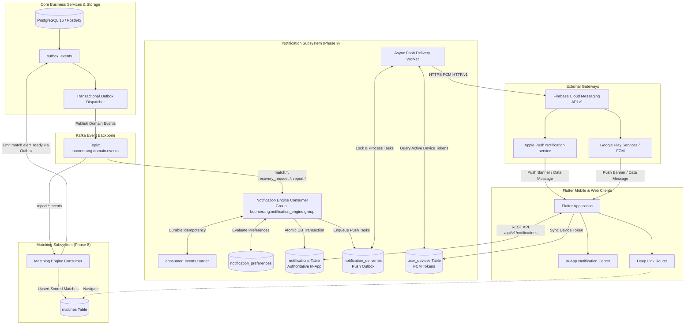
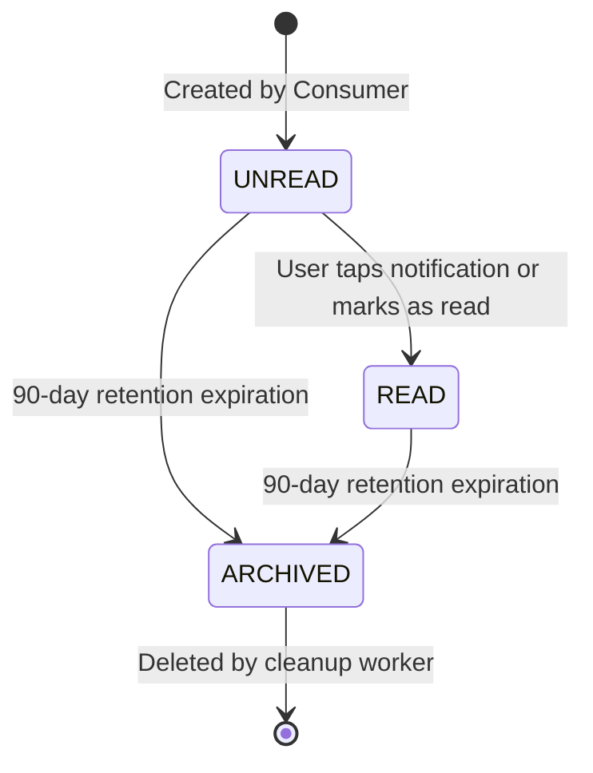
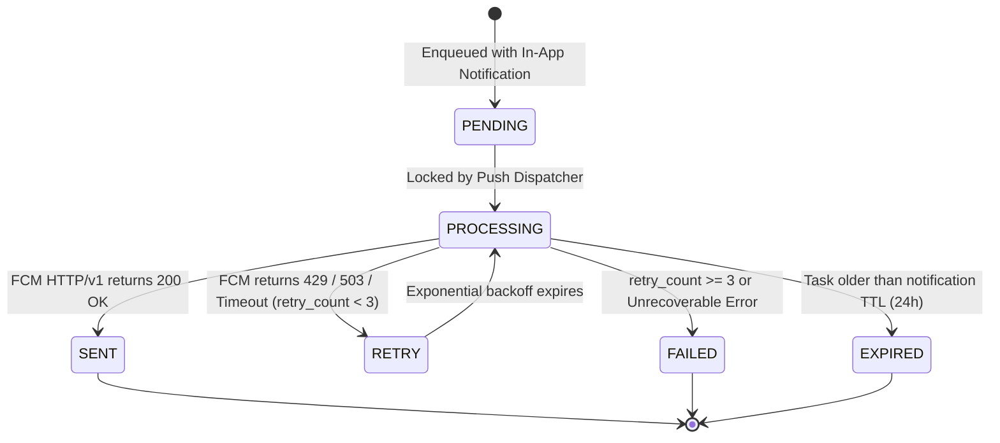
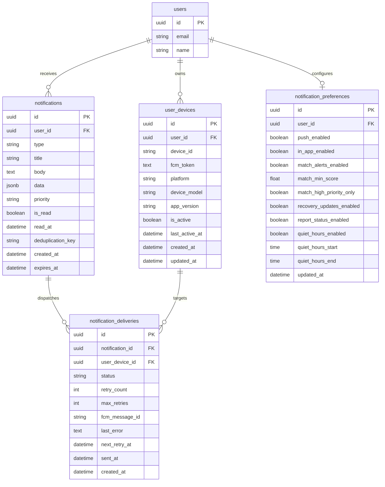

# Boomerang Notification System Specification (Phase 9.1)

> **Status Notice**: Phase 9.1 defines the formal architecture, event flow, data models, state machines, privacy rules, anti-spam policies, and phased implementation roadmap for the Boomerang Notification Subsystem.  
> **Implementation Scope**: This document establishes architectural rules, schemas, and API contracts only. No code, database migrations, or third-party dependencies are implemented in Phase 9.1. Existing Phase 7 event infrastructure, Phase 8 matching algorithms, and Flutter UI remain unmodified.

---

## 1. System Role & Architectural Context

The Boomerang Notification Subsystem is an asynchronous, event-driven pipeline designed to inform users of high-priority matches, recovery request lifecycle changes, and report status events across two primary channels:
1. **Authoritative In-App Notification Center**: A persistent, user-specific log of notifications stored in PostgreSQL, queryable via authenticated REST APIs and displayed within the Flutter app.
2. **Real-Time Mobile Push Notifications**: Low-latency, privacy-safe notifications dispatched via Firebase Cloud Messaging (FCM) to active Android, iOS, and Web devices.

### 1.1 Architectural Topology



### 1.2 Separation of Concerns

1. **Kafka's Role**: Transports immutable domain events (`match.alert_ready`, `recovery_request.created`, `recovery_request.updated`, `report.resolved`). Kafka partitions are keyed by `aggregate_id` (report UUID, recovery request UUID, or canonical match UUID). Kafka does **not** track push token delivery or store user read statuses.
2. **PostgreSQL's Role**: Serves as the authoritative source of truth for in-app notification state (`notifications`), user device tokens (`user_devices`), user opt-in preferences (`notification_preferences`), and push delivery audit logs (`notification_deliveries`).
3. **Consumer Worker's Role**: Evaluates user preferences, validates minimum score barriers, suppresses notification spam, persists authoritative in-app notification rows, and atomically enqueues push tasks.
4. **Push Dispatcher's Role**: Asynchronously delivers FCM push messages, handles HTTP/v1 backoff retries, and invalidates expired or revoked device tokens without blocking Kafka consumer throughput.

---

## 2. Evaluation of Notification Creation Architecture

A fundamental architectural decision is whether notification records should be created directly inside the Kafka event consumer handler or dispatched through a dedicated notification outbox.

### 2.1 Evaluated Architectural Patterns

| Pattern | Description | Failure Modes & Risks | Verdict |
| :--- | :--- | :--- | :--- |
| **Pattern 1: Synchronous Consumer Push** | The Kafka consumer receives a domain event, writes to `notifications`, and immediately issues a synchronous HTTP call to FCM before committing the database transaction and Kafka offset. | **High Risk**: FCM network latency (200ms–2s) blocks consumer threads. A network timeout after FCM accepts the message rolls back the PostgreSQL transaction, causing the consumer to retry and send **duplicate push notifications** to the user. | **REJECTED** |
| **Pattern 2: Pure Async Outbox Polling** | Kafka consumer writes an in-app `Notification` and enqueues an outbox row. A background worker periodically polls the table with `SELECT ... FOR UPDATE SKIP LOCKED` and dispatches to FCM. | **Low Risk / Safe**: Completely decouples Kafka from FCM. Safe across restarts. Slight delivery latency (1–3 seconds polling jitter). | **ACCEPTABLE** |
| **Pattern 3: Hybrid Two-Tier Notification Pipeline (Recommended)** | Kafka consumer atomically commits the in-app `Notification` and a `notification_deliveries` outbox record inside the consumer database transaction. Immediately upon database commit, an in-memory `asyncio` task notifies the local push dispatcher to trigger immediate push delivery; a secondary polling sweeper acts as a fallback for stranded or retried deliveries. | **Optimal**: Sub-second push delivery latency while preserving strict transactional isolation. External FCM outages or rate limits never block Kafka partitions or roll back in-app notification history. | **SELECTED** |

### 2.2 Selected Architecture: Hybrid Two-Tier Pipeline

Under the Hybrid Two-Tier Pipeline:
- **Tier 1 (Authoritative In-App Persistence)**:
  - The Kafka consumer processes domain events within an atomic database transaction.
  - Validates event idempotency using the existing `ConsumerEvent` barrier.
  - Queries user preferences and evaluates deduplication rules.
  - Persists the unread `Notification` record.
  - Enqueues a `notification_deliveries` record for each active user device.
  - Commits atomically: if the database transaction aborts, neither the in-app notification nor push tasks are persisted, and the Kafka offset does not advance.
- **Tier 2 (Asynchronous Push Dispatcher)**:
  - An independent asynchronous worker pool reads pending tasks from `notification_deliveries`.
  - Dispatches to FCM via HTTP/v1 API with exponential backoff and jitter.
  - **In-App Independence Invariant**: A failure during push delivery (e.g. FCM 503, invalid token, device offline) **never** rolls back or invalidates the authoritative in-app `Notification` record. The notification remains accessible in the user's in-app notification feed.

---

## 3. Event-to-Notification Mapping Specification

### 3.1 Event Mapping Matrix

| Domain Event | Target Recipient(s) | Notification Type | Default Channels | Minimum Threshold / Condition | User Deep Link |
| :--- | :--- | :--- | :--- | :--- | :--- |
| `match.alert_ready` (New Match, $S \ge 80$) | Both Report Owners (Missing Owner & Found Owner) | `MATCH_HIGH_PRIORITY` | Push + In-App | $S \ge 80$, `alert_eligible == True`, no prior alert for canonical pair. | `boomerang://matches/{match_id}` |
| `match.alert_ready` (New Match, $75 \le S < 80$) | Newly Reporting User Only | `MATCH_DETECTED` | Push + In-App | $75 \le S < 80$, `alert_eligible == True`. Existing owner excluded (Option B). | `boomerang://matches/{match_id}` |
| `match.alert_ready` (Rescored Match) | Affected Report Owner(s) | `MATCH_UPDATED` | In-App (Push only if $\Delta S \ge +10$ or becomes High Priority) | $\Delta S \ge +10$ points OR crosses into $S \ge 80$, minimum 4h cooldown. | `boomerang://matches/{match_id}` |
| `match.alert_ready` ($S < 75$ or Disqualified) | None | N/A | **Suppressed** | Scores $< 75$ or failing hard filters produce zero alerts. | None |
| `recovery_request.created` | Report Author (`recipient_id`) | `RECOVERY_REQUEST_RECEIVED` | Push + In-App | Always (Mandatory claim alert). | `boomerang://recovery-requests?tab=received&id={request_id}` |
| `recovery_request.updated` (`ACCEPTED`) | Requester (`requester_id`) | `RECOVERY_REQUEST_ACCEPTED` | Push + In-App | Status transitioned to `ACCEPTED`. | `boomerang://recovery-requests?tab=sent&id={request_id}` |
| `recovery_request.updated` (`REJECTED`) | Requester (`requester_id`) | `RECOVERY_REQUEST_REJECTED` | In-App (Push optional) | Status transitioned to `REJECTED`. | `boomerang://recovery-requests?tab=sent&id={request_id}` |
| `recovery_request.updated` (`COMPLETED`) | Both Requester & Recipient | `RECOVERY_REQUEST_COMPLETED` | Push + In-App | Handover finalized; item recovered. | `boomerang://reports/{report_id}` |
| `report.resolved` | Report Author (`created_by_user_id`) | `REPORT_STATUS_CHANGED` | In-App | Confirmation of resolution. Associated active matches marked resolved. | `boomerang://reports/{report_id}` |
| `report.expiring_soon` (Cron-driven) | Report Author (`created_by_user_id`) | `REPORT_EXPIRING` | Push + In-App | 7 days prior to 30-day report expiration date. | `boomerang://reports/{report_id}` |

---

## 4. Anti-Spam, Deduplication & Score Oscillation Suppression

To maintain user trust and avoid notification fatigue, the notification pipeline enforces strict throttling, oscillation guards, and deduplication barriers.

### 4.1 Canonical Report-Pair Deduplication
- For any canonical match pair `(report_missing_id, report_found_id)`:
  - The initial alert generates a deterministic deduplication key:
    $$\text{dedup\_key} = \text{"match:initial:"} + \min(\text{rep}_A, \text{rep}_B) + \text{":"} + \max(\text{rep}_A, \text{rep}_B) + \text{":user:"} + \text{user\_id}$$
  - A unique constraint on `(user_id, deduplication_key)` in PostgreSQL prevents duplicate initial alerts from ever being delivered to the same user, even under concurrent worker execution or Kafka replays.

### 4.2 Score Oscillation Suppression Rules
- **Micro-Fluctuation Filter**: When a report is edited with minor text changes, score fluctuations of $\Delta S < 5.0$ points are **strictly suppressed**.
- **Update Notification Criteria**: An existing match will trigger a notification update if and only if:
  1. The composite score transitions from $< 80$ to $\ge 80$ (`POSSIBLE_MATCH` $\rightarrow$ `HIGH_PRIORITY`), OR
  2. The composite score improves by $\ge +10.0$ points, OR
  3. A new specific physical characteristic (e.g. matching serial number or distinctive sticker) is detected.
- **Cooldown Window**: A minimum cooldown period of **4 hours** must elapse between update notifications for the same report pair.
- **Silent Demotions**: If an active match rescores downwards (e.g. from 82 to 65) or transitions to `SUPPRESSED` / `DISQUALIFIED`, **zero push notifications** are dispatched. The change is reflected silently in database status without disturbing the user.

---

## 5. Notification Lifecycle & State Machine

The system manages two distinct lifecycles: **In-App Notification Status** and **Push Delivery Status**.

### 5.1 In-App Notification State Machine



- **`UNREAD`**: Default state upon insertion. Increments the user's unread badge counter.
- **`READ`**: Transitioned when the user opens the notification in Flutter or invokes `PATCH /api/v1/notifications/{id}/read`.
- **`ARCHIVED`**: Automatically transitioned after 90 days. Excluded from active feed queries.

### 5.2 Push Delivery Task State Machine



- **`PENDING`**: Enqueued for dispatch to an active user device token.
- **`PROCESSING`**: Locked via `SELECT ... FOR UPDATE SKIP LOCKED` by an async push worker.
- **`SENT`**: FCM accepted message; `fcm_message_id` recorded.
- **`RETRY`**: Transient failure; scheduled with exponential backoff: $t_{\text{retry}} = 2^{\text{retry\_count}} \times 5\text{s} + \text{jitter}$.
- **`FAILED`**: Max retries exceeded; logged for audit. In-app notification remains untouched.

---

## 6. Proposed Database Models & Constraints



### 6.1 SQLAlchemy Model Specifications

```python
import enum
import uuid
from datetime import datetime, time
from typing import Any
from sqlalchemy import (
    BigInteger,
    Boolean,
    CheckConstraint,
    DateTime,
    Enum,
    Float,
    ForeignKey,
    Index,
    String,
    Text,
    Time,
    UniqueConstraint,
)
from sqlalchemy.dialects.postgresql import JSONB, UUID as pg_UUID
from sqlalchemy.orm import Mapped, mapped_column, relationship
from sqlalchemy.sql import func
from app.db.database import Base


class NotificationType(enum.StrEnum):
    MATCH_DETECTED = "MATCH_DETECTED"
    MATCH_HIGH_PRIORITY = "MATCH_HIGH_PRIORITY"
    MATCH_UPDATED = "MATCH_UPDATED"
    RECOVERY_REQUEST_RECEIVED = "RECOVERY_REQUEST_RECEIVED"
    RECOVERY_REQUEST_ACCEPTED = "RECOVERY_REQUEST_ACCEPTED"
    RECOVERY_REQUEST_REJECTED = "RECOVERY_REQUEST_REJECTED"
    RECOVERY_REQUEST_COMPLETED = "RECOVERY_REQUEST_COMPLETED"
    REPORT_STATUS_CHANGED = "REPORT_STATUS_CHANGED"
    REPORT_EXPIRING = "REPORT_EXPIRING"


class NotificationPriority(enum.StrEnum):
    HIGH = "HIGH"
    DEFAULT = "DEFAULT"
    LOW = "LOW"


class DeliveryStatus(enum.StrEnum):
    PENDING = "PENDING"
    PROCESSING = "PROCESSING"
    SENT = "SENT"
    FAILED = "FAILED"
    EXPIRED = "EXPIRED"


class DevicePlatform(enum.StrEnum):
    ANDROID = "ANDROID"
    IOS = "IOS"
    WEB = "WEB"


class Notification(Base):
    __tablename__ = "notifications"
    __table_args__ = (
        UniqueConstraint(
            "user_id", "deduplication_key", name="uq_notifications_user_dedup"
        ),
        Index("ix_notifications_user_read_created", "user_id", "is_read", "created_at"),
        Index("ix_notifications_expires_at", "expires_at"),
    )

    id: Mapped[uuid.UUID] = mapped_column(
        pg_UUID(as_uuid=True), primary_key=True, default=uuid.uuid4
    )
    user_id: Mapped[uuid.UUID] = mapped_column(
        ForeignKey("users.id", ondelete="CASCADE"), nullable=False, index=True
    )
    type: Mapped[NotificationType] = mapped_column(
        Enum(NotificationType, name="notification_type_enum"), nullable=False, index=True
    )
    title: Mapped[str] = mapped_column(String(120), nullable=False)
    body: Mapped[str] = mapped_column(Text, nullable=False)
    data: Mapped[dict[str, Any]] = mapped_column(JSONB, nullable=False, default=dict)
    priority: Mapped[NotificationPriority] = mapped_column(
        Enum(NotificationPriority, name="notification_priority_enum"),
        nullable=False,
        default=NotificationPriority.DEFAULT,
    )
    is_read: Mapped[bool] = mapped_column(Boolean, nullable=False, default=False, index=True)
    read_at: Mapped[datetime | None] = mapped_column(DateTime(timezone=True), nullable=True)
    deduplication_key: Mapped[str | None] = mapped_column(String(255), nullable=True)

    created_at: Mapped[datetime] = mapped_column(
        DateTime(timezone=True), server_default=func.now(), nullable=False, index=True
    )
    expires_at: Mapped[datetime] = mapped_column(
        DateTime(timezone=True), nullable=False
    )

    user: Mapped["User"] = relationship("User", back_populates="notifications")
    deliveries: Mapped[list["NotificationDelivery"]] = relationship(
        "NotificationDelivery", back_populates="notification", cascade="all, delete-orphan"
    )


class UserDevice(Base):
    __tablename__ = "user_devices"
    __table_args__ = (
        UniqueConstraint("user_id", "device_id", name="uq_user_devices_user_device"),
        Index("ix_user_devices_fcm_token", "fcm_token"),
    )

    id: Mapped[uuid.UUID] = mapped_column(
        pg_UUID(as_uuid=True), primary_key=True, default=uuid.uuid4
    )
    user_id: Mapped[uuid.UUID] = mapped_column(
        ForeignKey("users.id", ondelete="CASCADE"), nullable=False, index=True
    )
    device_id: Mapped[str] = mapped_column(String(100), nullable=False)
    fcm_token: Mapped[str] = mapped_column(Text, nullable=False)
    platform: Mapped[DevicePlatform] = mapped_column(
        Enum(DevicePlatform, name="device_platform_enum"), nullable=False
    )
    device_model: Mapped[str | None] = mapped_column(String(100), nullable=True)
    app_version: Mapped[str | None] = mapped_column(String(20), nullable=True)
    is_active: Mapped[bool] = mapped_column(Boolean, nullable=False, default=True, index=True)

    last_active_at: Mapped[datetime] = mapped_column(
        DateTime(timezone=True), server_default=func.now(), nullable=False
    )
    created_at: Mapped[datetime] = mapped_column(
        DateTime(timezone=True), server_default=func.now(), nullable=False
    )
    updated_at: Mapped[datetime] = mapped_column(
        DateTime(timezone=True), server_default=func.now(), onupdate=func.now(), nullable=False
    )

    user: Mapped["User"] = relationship("User", back_populates="devices")
    deliveries: Mapped[list["NotificationDelivery"]] = relationship(
        "NotificationDelivery", back_populates="device", cascade="all, delete-orphan"
    )


class NotificationPreference(Base):
    __tablename__ = "notification_preferences"
    __table_args__ = (
        CheckConstraint(
            "match_min_score >= 60.0 AND match_min_score <= 100.0",
            name="chk_notif_pref_match_min_score",
        ),
    )

    id: Mapped[uuid.UUID] = mapped_column(
        pg_UUID(as_uuid=True), primary_key=True, default=uuid.uuid4
    )
    user_id: Mapped[uuid.UUID] = mapped_column(
        ForeignKey("users.id", ondelete="CASCADE"), nullable=False, unique=True, index=True
    )
    push_enabled: Mapped[bool] = mapped_column(Boolean, nullable=False, default=True)
    in_app_enabled: Mapped[bool] = mapped_column(Boolean, nullable=False, default=True)
    match_alerts_enabled: Mapped[bool] = mapped_column(Boolean, nullable=False, default=True)
    match_min_score: Mapped[float] = mapped_column(Float, nullable=False, default=75.0)
    match_high_priority_only: Mapped[bool] = mapped_column(Boolean, nullable=False, default=False)
    recovery_updates_enabled: Mapped[bool] = mapped_column(Boolean, nullable=False, default=True)
    report_status_enabled: Mapped[bool] = mapped_column(Boolean, nullable=False, default=True)
    quiet_hours_enabled: Mapped[bool] = mapped_column(Boolean, nullable=False, default=False)
    quiet_hours_start: Mapped[time | None] = mapped_column(Time, nullable=True)
    quiet_hours_end: Mapped[time | None] = mapped_column(Time, nullable=True)

    updated_at: Mapped[datetime] = mapped_column(
        DateTime(timezone=True), server_default=func.now(), onupdate=func.now(), nullable=False
    )

    user: Mapped["User"] = relationship("User", back_populates="notification_preferences")


class NotificationDelivery(Base):
    __tablename__ = "notification_deliveries"
    __table_args__ = (
        Index("ix_notification_deliveries_status_retry", "status", "next_retry_at"),
    )

    id: Mapped[uuid.UUID] = mapped_column(
        pg_UUID(as_uuid=True), primary_key=True, default=uuid.uuid4
    )
    notification_id: Mapped[uuid.UUID] = mapped_column(
        ForeignKey("notifications.id", ondelete="CASCADE"), nullable=False, index=True
    )
    user_device_id: Mapped[uuid.UUID] = mapped_column(
        ForeignKey("user_devices.id", ondelete="CASCADE"), nullable=False, index=True
    )
    status: Mapped[DeliveryStatus] = mapped_column(
        Enum(DeliveryStatus, name="delivery_status_enum"),
        nullable=False,
        default=DeliveryStatus.PENDING,
        index=True,
    )
    retry_count: Mapped[int] = mapped_column(nullable=False, default=0)
    max_retries: Mapped[int] = mapped_column(nullable=False, default=3)
    fcm_message_id: Mapped[str | None] = mapped_column(String(255), nullable=True)
    last_error: Mapped[str | None] = mapped_column(Text, nullable=True)
    next_retry_at: Mapped[datetime] = mapped_column(
        DateTime(timezone=True), server_default=func.now(), nullable=False
    )
    sent_at: Mapped[datetime | None] = mapped_column(DateTime(timezone=True), nullable=True)
    created_at: Mapped[datetime] = mapped_column(
        DateTime(timezone=True), server_default=func.now(), nullable=False
    )

    notification: Mapped["Notification"] = relationship("Notification", back_populates="deliveries")
    device: Mapped["UserDevice"] = relationship("UserDevice", back_populates="deliveries")
```

---

## 7. REST API Proposal

Endpoints mounted under `${settings.API_V1_STR}/notifications`:

### 7.1 Endpoint Catalog

| Method | Path | Summary | Auth Required | Request Payload | Response Model |
| :--- | :--- | :--- | :---: | :--- | :--- |
| `GET` | `/notifications` | List user in-app notifications (paginated) | Yes | Query: `is_read`, `type`, `page`, `page_size` | `NotificationListResponse` |
| `GET` | `/notifications/unread-count` | Fast unread badge count | Yes | None | `UnreadCountResponse` |
| `PATCH` | `/notifications/{id}/read` | Mark single notification as read | Yes | None | `NotificationResponse` |
| `POST` | `/notifications/mark-all-read` | Mark all unread notifications as read | Yes | None | `BulkActionResponse` |
| `DELETE` | `/notifications/{id}` | Dismiss/delete single notification | Yes | None | Status 204 No Content |
| `GET` | `/notifications/preferences` | Retrieve notification settings | Yes | None | `NotificationPreferenceResponse` |
| `PUT` | `/notifications/preferences` | Update notification settings | Yes | `UpdateNotificationPreferenceRequest` | `NotificationPreferenceResponse` |
| `POST` | `/notifications/devices` | Register or refresh FCM device token | Yes | `RegisterDeviceRequest` | `DeviceResponse` |
| `DELETE` | `/notifications/devices/{device_id}` | Deactivate device token on logout | Yes | None | Status 204 No Content |

### 7.2 Core Pydantic Schemas

```python
class NotificationResponse(BaseModel):
    id: uuid.UUID
    type: NotificationType
    title: str
    body: str
    data: dict[str, Any]
    priority: NotificationPriority
    is_read: bool
    read_at: datetime | None
    created_at: datetime

    model_config = ConfigDict(from_attributes=True)


class NotificationListResponse(BaseModel):
    items: list[NotificationResponse]
    unread_count: int
    page: int
    page_size: int
    total: int
    total_pages: int


class UnreadCountResponse(BaseModel):
    unread_count: int


class RegisterDeviceRequest(BaseModel):
    device_id: str = Field(..., min_length=1, max_length=100)
    fcm_token: str = Field(..., min_length=10)
    platform: DevicePlatform
    device_model: str | None = Field(default=None, max_length=100)
    app_version: str | None = Field(default=None, max_length=20)


class UpdateNotificationPreferenceRequest(BaseModel):
    push_enabled: bool | None = None
    in_app_enabled: bool | None = None
    match_alerts_enabled: bool | None = None
    match_min_score: float | None = Field(default=None, ge=60.0, le=100.0)
    match_high_priority_only: bool | None = None
    recovery_updates_enabled: bool | None = None
    report_status_enabled: bool | None = None
    quiet_hours_enabled: bool | None = None
    quiet_hours_start: time | None = None
    quiet_hours_end: time | None = None
```

---

## 8. Flutter Client Integration Architecture

### 8.1 Client Layer Structure

```text
frontend/lib/
├── models/
│   ├── notification_model.dart            # In-App notification DTOs & unread counts
│   └── notification_preference_model.dart # Settings & quiet hours DTO
├── services/
│   ├── notification_service.dart          # FCM token listener, background isolate, push handler
│   └── notification_repository.dart       # Observable in-app feed, unread badge counter, pagination
└── ui/
    ├── screens/
    │   ├── notifications_screen.dart      # In-App notification center with pull-to-refresh & swipe dismiss
    │   └── notification_settings_screen.dart # User preference toggles & quiet hours picker
    └── widgets/
        ├── notification_badge_icon.dart   # App bar bell icon with live unread badge counter
        └── notification_item_card.dart    # Monochrome item card with category icons and action routes
```

### 8.2 Client Push & Deep Link Flow

1. **Token Lifecycle**:
   - On app startup following authenticated session restore (`AuthService.instance.isAuthenticated`), `NotificationService` calls `FirebaseMessaging.instance.getToken()`.
   - Dispatches `POST /api/v1/notifications/devices` with hardware UUID and FCM token.
   - Subscribes to `FirebaseMessaging.instance.onTokenRefresh` to automatically update rotated tokens.
   - Upon `AuthService.instance.logout()`, invokes `DELETE /api/v1/notifications/devices/{device_id}` before clearing local secure storage.
2. **Foreground Message Presentation**:
   - In foreground state, FCM push messages do not automatically display system heads-up notifications.
   - `NotificationService.onMessage` parses the incoming payload and displays an in-app `AppToast` notification banner without interrupting user interaction.
   - Simultaneously increments `NotificationRepository.unreadCount`.
3. **Background & Terminated State Interaction**:
   - User taps push notification banner in system notification tray.
   - Handled via `FirebaseMessaging.onMessageOpenedApp` (background) or `FirebaseMessaging.instance.getInitialMessage()` (cold start).
   - Extracts payload `data`:
     ```json
     {
       "entity_type": "match",
       "entity_id": "9b1deb4d-3b7d-4bad-9bdd-2b0d7b3dcb6d",
       "deep_link": "boomerang://matches/9b1deb4d-3b7d-4bad-9bdd-2b0d7b3dcb6d"
     }
     ```
   - Routes to authenticated destination screen:
     - `entity_type == "match"` $\rightarrow$ `MatchDetailScreen(matchId: entity_id)`
     - `entity_type == "recovery_request"` $\rightarrow$ `RecoveryRequestsScreen()`
     - `entity_type == "report"` $\rightarrow$ `ReportDetailsScreen(reportId: entity_id)`

---

## 9. Privacy, Security & Data Protection Policies

To guarantee absolute compliance with user privacy, zero data leaks, and strict authorization:

1. **Zero Incident Coordinate Leakage**:
   - Push notifications are transmitted across third-party networks (Google FCM, Apple APNs).
   - Push payloads must **never** contain exact GPS coordinates (`latitude`, `longitude`) or PostGIS geometry.
   - Geographic context is restricted strictly to relative proximity (e.g. `"within 400m"`) or macro category.
2. **Zero Verification Proof Leakage**:
   - Recovery claim messages, proof descriptions, or verification responses must **never** appear in push notification text.
   - Push body is generic: `"New recovery request received for your report."` Full claim verification details require logging into the authenticated app.
3. **Strict IDOR Protection**:
   - All notification queries filter strictly by `user_id == current_user.id`.
   - Accessing another user's notification returns `404 Not Found` or `403 Forbidden`.
4. **Token Isolation**:
   - Device tokens are bound to the specific user account.
   - When a user logs out, the device token is deactivated immediately so subsequent users on shared tablets or devices do not receive private alerts.

---

## 10. Multi-Device, Token Invalidation & Failure Recovery

### 10.1 Multi-Device Fan-Out
- A user may be logged in simultaneously on a phone, a tablet, and a web browser.
- When an event occurs, the notification engine queries all active records in `user_devices` for `user_id`.
- Creates a `NotificationDelivery` task for each device, allowing parallel dispatch.

### 10.2 FCM Token Invalidation Handling
When the async push worker calls the FCM HTTP/v1 API:
- If FCM responds with `404 Not Found` or error code `UNREGISTERED` / `INVALID_ARGUMENT` (app uninstalled or token expired):
  - The worker immediately marks `UserDevice.is_active = False` in PostgreSQL.
  - Future delivery tasks for that token are canceled.
- If FCM responds with `429 Too Many Requests` or `503 Service Unavailable`:
  - The task transitions to `RETRY` with exponential backoff up to `max_retries = 3`.

### 10.3 Failure Recovery & Crash Semantics
- **Database Crash during Notification Ingestion**: If PostgreSQL crashes while the Kafka consumer is processing an event, the uncommitted transaction rolls back. Kafka offset has not advanced. Upon restart, Kafka redelivers the event; consumer idempotency barrier (`ConsumerEvent`) prevents duplicate processing.
- **Push Dispatcher Crash**: If the push worker crashes while processing tasks, tasks remain in `PROCESSING` state. A background watchdog resets orphaned tasks older than 5 minutes back to `PENDING`.
- **FCM Outage**: Outages at Google do not impact in-app notifications. In-app notifications remain queryable immediately by Flutter clients.

---

## 11. Notification Retention & Cleanup Policy

1. **Time-To-Live (TTL)**:
   - In-App Notifications: Retained for **90 days** from `created_at`.
   - Push Delivery Logs (`notification_deliveries`): Retained for **30 days** for debugging and telemetry audits.
2. **Automated Pruning**:
   - A lightweight recurring cron job (`DELETE FROM notifications WHERE expires_at < NOW()`) safely removes expired notifications in small batches (`LIMIT 1000`) to avoid table lock contention.
3. **Storage Ceiling**:
   - A hard cap of **500 in-app notifications** per user account is enforced; oldest read notifications are pruned when ceiling is exceeded.

---

## 12. Phased Implementation Roadmap (Phases 9.2 – 9.8)

| Phase | Milestone | Deliverables | Verification Strategy |
| :--- | :--- | :--- | :--- |
| **Phase 9.2** | **Database Models & Alembic Migrations** | `Notification`, `UserDevice`, `NotificationPreference`, `NotificationDelivery` SQLAlchemy models, migration script, and repository layer. | Bidirectional migration tests (`downgrade -1`, `upgrade head`), model constraint tests, repository unit tests. |
| **Phase 9.3** | **Kafka Event Contracts & Notification Consumer** | `match.alert_ready` event contract, Kafka consumer group `boomerang.notification_engine.group`, preference evaluator, deduplication barrier. | Consumer unit & integration tests, deduplication tests, score oscillation suppression tests. |
| **Phase 9.4** | **Async Push Dispatcher & FCM Service** | Async push worker pool, FCM HTTP/v1 client with mock service for CI, token invalidation handler, exponential backoff retries. | FCM mock delivery tests, invalid token retirement tests, retry backoff tests. |
| **Phase 9.5** | **FastAPI Notification Endpoints** | REST routes for listing, unread counts, mark-as-read, device registration, and preference management. | Pytest API integration tests covering 200, 401, 403, 404, 422, pagination, and bulk actions. |
| **Phase 9.6** | **Flutter Notification Client & UI** | `NotificationModel`, `NotificationRepository`, `NotificationService`, `NotificationsScreen`, unread badge icon, and settings UI. | Flutter unit and widget tests for models, repository, notification center, and settings screen. |
| **Phase 9.7** | **Deep Linking & Push Routing** | System push notification click handling, deep link routing to `MatchDetailScreen`, `ReportDetailsScreen`, `RecoveryRequestsScreen`, foreground toast. | Flutter widget and integration tests simulating push taps and verifying destination routes. |
| **Phase 9.8** | **End-to-End Verification & Production Hardening** | Full end-to-end integration test from report creation $\rightarrow$ match detection $\rightarrow$ notification ingestion $\rightarrow$ push dispatch $\rightarrow$ in-app verification. Multi-device verification. | End-to-end backend integration tests, full Flutter suite, and automated anti-spam load benchmark. |

---

## 13. Explicit Assumptions & Unresolved Decisions

### 13.1 Explicit Assumptions
1. **FCM as Unified Gateway**: Mobile push delivery utilizes Firebase Cloud Messaging HTTP/v1 API for Android, iOS (via APNs integration in Firebase), and Web. Direct raw APNs integration without Firebase is out of scope.
2. **Report Expiration Period**: Reports have an assumed active lifespan of 30 days unless renewed or resolved.
3. **Match Alert Threshold**: Automatic push alerts require composite score $S \ge 75$ with `alert_eligible == True` (satisfying Minimum Evidence Requirement). Matches between 40 and 74 appear in manual search but do not fire push alerts.

### 13.2 Unresolved Decisions & Open Policy Questions
1. **Email Notification Channel**: Whether email digests (e.g. SendGrid or Amazon SES) should be added in Phase 9 or deferred to Phase 10. *Recommendation*: Schema includes `email_enabled` flag, but implementation is deferred to Phase 10.
2. **Quiet Hours Enforcement on High Priority Matches**: Should high-priority matches ($S \ge 90$) bypass user-configured quiet hours? *Recommendation*: Respect user quiet hours strictly for privacy and battery considerations, buffering delivery until quiet hours end.
3. **Matching Engine Event Emission**: Whether Phase 8.5 `MatchPersistenceService` should emit `match.alert_ready` directly into `outbox_events` during `record_matches()`, or if the Matching Worker should emit it after persistence completes. *Recommendation*: Enqueue in `outbox_events` in the exact same database transaction as `Match` persistence to guarantee atomicity.

